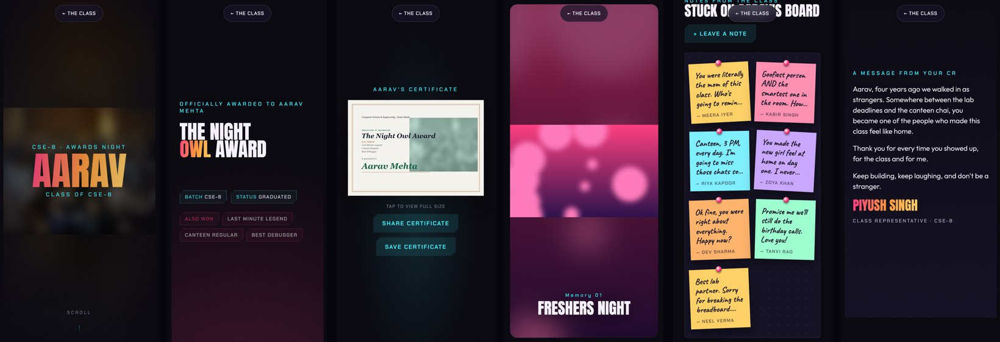
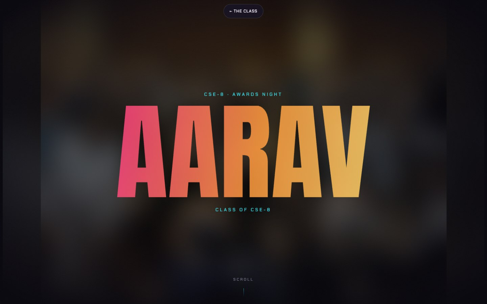
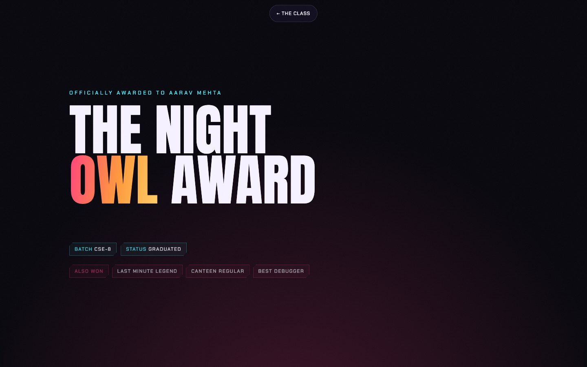
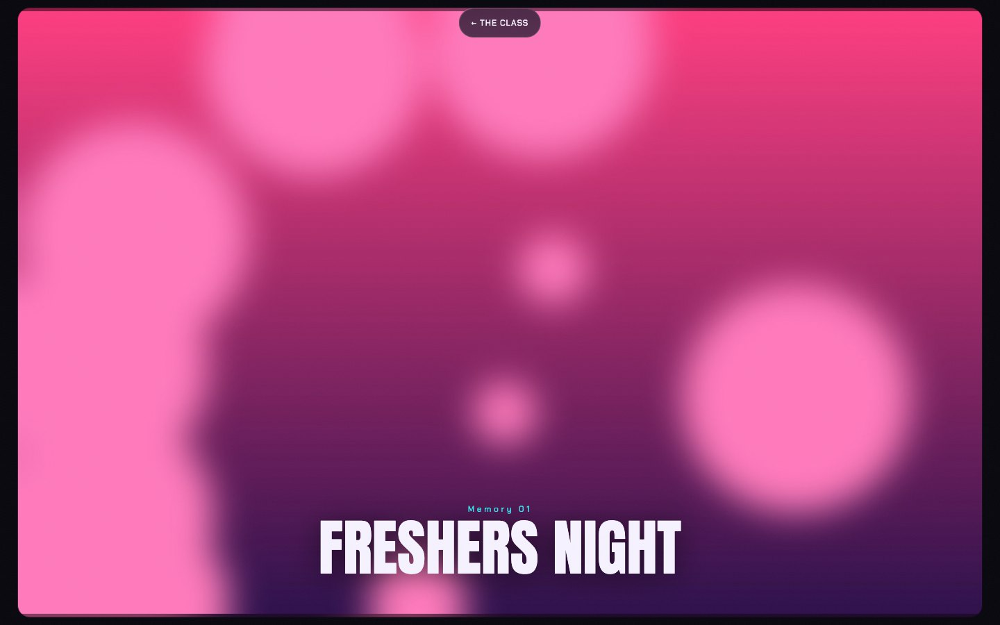
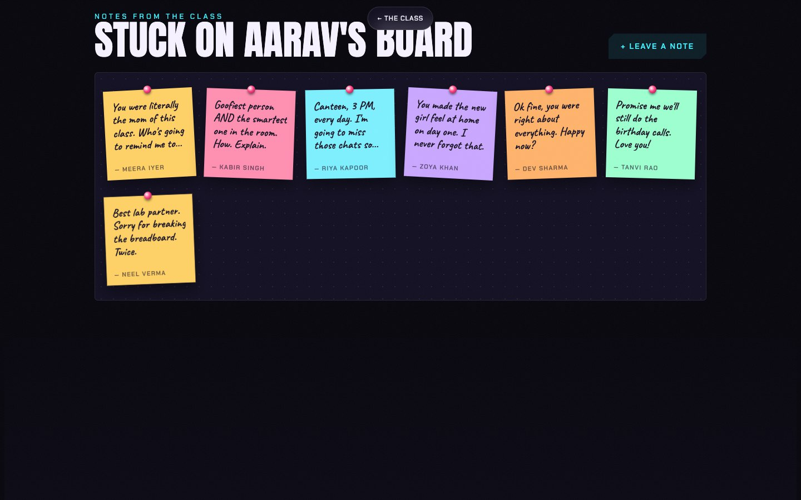
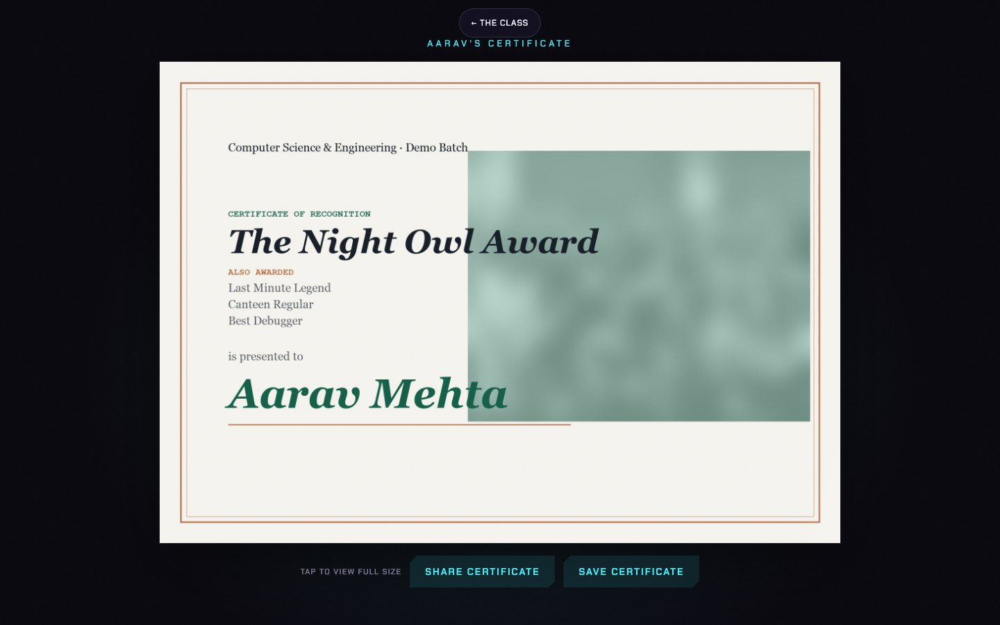
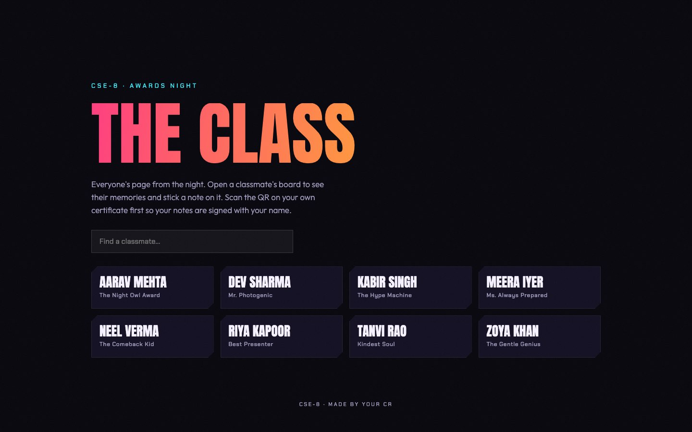

# CSE-8 Awards Night

A personal web page behind every award certificate.

For our class awards night I gave each of my 54 CSE-8 classmates a printed certificate. Each one carried a QR code that opens that student's own page: their name flying in over our class photo, their award, a digital copy of the certificate, a personal message from me as CR, a memory board for their own photos, and a wall where classmates stick post-it notes.

**Live:** [cse8-awards.vercel.app](https://cse8-awards.vercel.app). Pages are only reachable through each student's QR or the class directory, and are hidden from search engines.

> All screenshots below use made-up students and placeholder photos. The real class data is not in this repository.

<p align="center"></p>

| Name intro | Award |
|---|---|
|  |  |
| **Memory with a title** | **Notes from classmates** |
|  |  |
| **Certificate** | **Class directory** |
|  |  |

## In use

- 54 personal pages, one per student, each linked from a printed QR code
- 41 of 54 students claimed their board
- 229 notes across 46 boards, and 41 photos

## Features

- **Scroll-driven page.** Sticky full-screen scenes; scroll position drives every reveal (name fly-through, award words lighting up, certificate tilting up, memories zooming to full screen, a horizontal highlight reel).
- **Memory board.** The owner uploads photos, shrunk on the phone before upload (1600 px, JPEG 0.82). The first two get their own full-screen scenes and the rest go in a highlight reel. Tap any photo to view it whole and give it a title.
- **Notes wall.** Classmates stick post-its (300 characters) on each other's boards, signed automatically with their own name.
- **Class directory** with search, so friends can find each other's boards.
- **Share or save the certificate.** Sharing uses the phone's share sheet, and always the web copy without the QR.
- **Admin mode** for the CR: see who has claimed a board, reset forgotten passwords, remove any note or photo.

## How the security works

**The QR is a signed link, not a random ID.** Each QR encodes `/<student-id>?k=<key>`, where the key is `HMAC-SHA256(server secret, student-id)` cut to 12 base64url characters (about 72 bits). The server recomputes and compares it in constant time, so no list of keys is stored anywhere and keys can't be forged without the secret. The key is removed from the address bar right after scanning.

**A shared photo of a certificate shouldn't unlock the board.** Certificates get photographed and posted, and the codes were already printed. So:

1. The first scan asks the owner to set a password. It is stored as a **scrypt** hash with a per-board random salt.
2. The phone gets a session token, `HMAC(secret, id + password-file timestamp)`, and stays logged in.
3. Every upload, note, title and delete checks that token. Without the password, a scanned QR gives a view-only page.
4. If two phones claim at once, the password file can only be created once, so the first wins and the other is asked for the password.
5. An admin reset deletes the password file; the timestamp changes, so every old session dies at once.
6. After 10 wrong passwords a board refuses logins for 15 minutes.

Other checks: notes and titles are length-capped and HTML-escaped on display, uploads must be JPEG under 4 MB, you can't post on your own board, and file paths are checked so requests can't escape the data folder.

## The incident: hitting Vercel Blob's operation limit

Three days after launch, Vercel emailed: *"used 100% of the included Advanced Operations for Vercel Blob. Your store access will be paused for 30 days."* Every photo and note was locked.

**Cause.** Not storage space: the whole dataset was about 5 MB of a 1 GB allowance. The free plan allows **2,000 advanced operations a month**, and listing a folder counts as one. Every board view listed that board's folder. With 54 different boards, a 2-minute CDN cache rarely got reused, so most of the budget went on people simply *viewing* pages.

**Recovery.**
1. Confirmed the data was paused, not deleted. File listing still worked but downloads were blocked.
2. Moved the project and the store into a team on Vercel's Pro trial. The URL stayed the same, so every printed QR kept working, and the store came back online.
3. Backed up all files and verified each one. The first attempt had silently saved 261 copies of *"Your store is blocked"*.
4. Migrated storage to a self-hosted VPS (below) and moved the Vercel team back to the free plan.

**Lessons.** Know which operation is metered, not just the headline limit. Cache hit rates depend on how many requests share a key. Anything printed is permanent, so the URL and signing secret had to survive any backend change. A backup isn't a backup until you've checked its contents.

## Architecture

```
 phone ── scans QR ──▶ cse8-awards.vercel.app     (Vercel, free: static pages)
                         │  /api/*  rewrite
                         ▼
                       VPS: Caddy (HTTPS) ──▶ Node API (systemd, unprivileged user)
                         │ /b/*  photos, notes, titles served from disk, cached 1 year
                         └ auth/ password hashes, never served
```

- **Frontend:** plain HTML, CSS and JavaScript, no framework (`public/`).
- **API:** small request handlers in `api/` (`board`, `photo`, `note`, `caption`, `delete`, `claim`, `me`, `admin`), written against the `@vercel/blob` interface.
- **Storage:** files, not a database: `b/<id>/photos`, `b/<id>/notes/<writer>`, `b/<id>/caps`, `auth/<id>.json`.
- **Self-hosting without rewriting the API.** `server/blob-shim` implements the same `list / head / put / del` calls on the local disk, and `server/server.mjs` runs the handlers as a Node HTTP server. The handlers are unchanged, so moving back to Vercel later is a deploy, not a rewrite.
- **Migration.** `server/mirror.mjs` copies every file out of Blob, keeping original upload times. That kept photos in order and kept all 41 existing logins valid, because sessions are tied to the password file's timestamp.
- **Ops.** systemd service with `ProtectSystem=strict` and `NoNewPrivileges`, Caddy for automatic HTTPS, daily tar backups kept for 14 days.

More detail in plain words: [docs/HOW-IT-WORKS.md](docs/HOW-IT-WORKS.md).

## Project layout

```
public/            index.html (class directory), student.html (personal page), style.css
api/               request handlers + _lib.js (keys, sessions, scrypt)
server/            VPS: server.mjs, blob-shim/, Caddyfile, systemd units, mirror.mjs
build.py           data/ → public/students.json, resized backgrounds and certificates
qr.mjs             one QR PNG + link per student
qrmatrix.mjs       exact QR module grids for stamping
print-cert.py      stamps each QR onto its certificate at 300 dpi (24 mm, fixed position)
backup.mjs         downloads every stored file
data.example/      the input format, with made-up students
```

## Running it yourself

You need Node 18+ and Python 3 with Pillow.

```bash
npm install
# your data lives outside the repo: awards.json, cr_messages.json, hot_words.json, backgrounds/, certificates/
# (see data.example/ for the format)
DATA_DIR=./data.example python3 build.py

# secrets (keep these out of git; .gitignore already does)
python3 -c "import secrets; print(secrets.token_urlsafe(32))" > .secret
python3 -c "import secrets; print(secrets.token_urlsafe(12))" > .admin

SITE_URL=https://your-site.example node qr.mjs        # writes qr/<id>.png and qr/links.csv
node qrmatrix.mjs && python3 print-cert.py           # print-ready certificates in print/
```

Deploy `public/` anywhere static. Run the API on Vercel (set `SECRET`, `ADMIN_KEY` and a Blob store) or on a server with `server/` (set `SECRET`, `ADMIN_KEY`, `FILES_HOST`, `DATA_DIR`). The generated QR links and print files contain private keys: never publish them.

## Built with

HTML, CSS, JavaScript, Node.js, Vercel (static hosting, rewrites, Blob), Caddy, systemd, Python and Pillow, `qrcode`.
